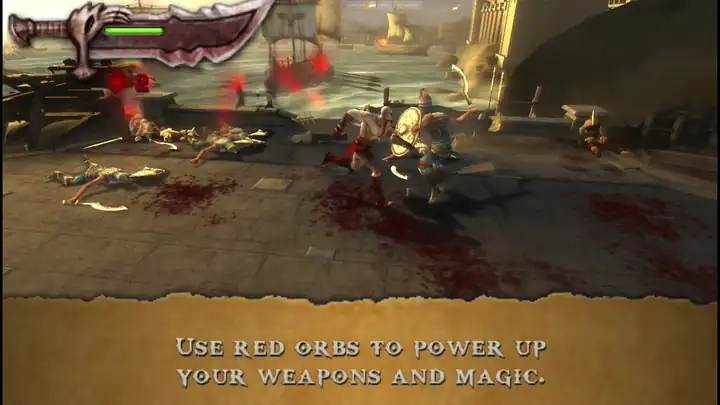

# NCAA Football 10 PSP Web Recomp

For a static host with a browser ISO picker, see [Static hosting](docs/STATIC_HOSTING.md). After building NCAA, `python scripts/prepare_static_ncaa.py --output build/static-ncaa10` prepares a self-contained web folder. Players select a matching US ISO locally; no disc server or upload is needed. The package includes the game-specific compiled build and verified boot preload.

This working project targets **NCAA Football 10 for PSP, US release ULUS10440**, running in the browser. Its decrypted Allegrex/MIPS executable is statically translated into C++, compiled to WebAssembly, and linked with the PSP kernel and WebGL2 graphics implementation in this project. It runs the game's own code and assets; gameplay does not use a PSP CPU interpreter or JIT.

The NCAA native and web builds default to **64 MiB guest RAM** with a 56 MiB user partition. `?ram=32` selects the original layout for comparison. UK–FSU kickoff and manually snapped scrimmage gameplay have been verified. Full rendering accuracy, sustained frame pacing, uninterrupted audio, and complete mode coverage remain work in progress.

The build checks the disc metadata and exact decrypted executable before linking `profile/generated/ncaa10` and the NCAA audio corpus. The internal module name `NCAA2007` belongs to this verified Football 10 executable. It does not select a different game.

Run commands from the repository root, where `scripts` and `profile` live. In the original local workspace this is the inner `psp-web-recomp-main` folder. If you already have a build, serve it with:

```powershell
python scripts/serve.py build/web-ncaa10/profiles/web 8621 --mount /disc=games/ncaa10/root/disc
```

Open <http://127.0.0.1:8621/> and press **Enter for Start**. See the [NCAA guide](docs/NCAA10.md) for building and controls.

| Document | Purpose |
| --- | --- |
| [Engineering log](ENGINEERING_LOG.md) | Verified identity, engineering milestones, evidence and unresolved defects |
| [Handoff](HANDOFF.md) | Resume the current build, tests, saves and debugging work |
| [Agent instructions](AGENTS.md) | Rules for future work on this NCAA port |
| [Helping other recomps](OTHER_RECOMPS.md) | Reusable fixes, test methods and contribution guidance |
| [GitHub publication](GITHUB_READY.md) | Published source, snapshot and contribution instructions for awest813/NCAA-10-PSP-Recomp |

Attribution and dependency licenses are summarized in [THIRD_PARTY_NOTICES.md](THIRD_PARTY_NOTICES.md).

A fresh clone contains source only. Game files, generated translations, build outputs and saves are excluded by `.gitignore`.

## Build NCAA from a fresh checkout

Install Git, Python 3.10 or newer, CMake, Ninja and a C++20 compiler. Windows users need Git Bash for setup and Clang on PATH. Run:

```bash
git clone https://github.com/awest813/NCAA-10-PSP-Recomp.git
cd NCAA-10-PSP-Recomp
bash scripts/setup.sh
```

Setup fetches the pinned PSPRecomp revision, applies all seven patches, links this profile and installs Emscripten 6.0.10. Supply your own US disc (`ULUS10440`) and the matching decrypted `EBOOT.BIN`; the executable hash is in the [NCAA guide](docs/NCAA10.md#verified-game-identity). Place the decrypted file at `games/ncaa10/root/EBOOT.BIN`, creating those directories first. A retail encrypted executable cannot be used directly.

On Windows, from PowerShell in the repository root:

```powershell
./scripts/build_ncaa_web.ps1 -Iso 'C:/path/to/NCAA-Football-10.iso' -Emsdk ./tools/emsdk -Generate -Serve
```

On Linux, from Bash:

```bash
scripts/port.sh ncaa10 '/path/to/NCAA-Football-10.iso'
scripts/serve.sh ncaa10 8621
```

The NCAA path verifies the executable and disc metadata, generates both executable and EA audio code, and prepares the raw UMD image used by sector reads. An ISO or a ZIP containing one ISO is supported. The Bash workflow also accepts an extracted-directory source containing `__umd.iso`. Existing raw images are checked by SHA-256 and preserved on a mismatch. Open <http://127.0.0.1:8621/> and press **Enter for Start**.

Windows gameplay is the verified baseline. Source checks and clean compiler reconstruction have local regression coverage; first-time Linux setup and a full Linux game build still need end-to-end validation. The new GitHub workflow checks source, browser helpers and the patched compiler without game data.

## Inherited PSP web runtime

The host runtime originated in PSP Web Recomp's God of War ports. The following demo and performance history describe those original titles, not NCAA's current accuracy or frame rate. NCAA's gameplay target is its observed native cadence of about 30 FPS at 100% simulation speed.

<p align="center">
  
  <br>
  <a href="docs/media/demo.mp4">Watch the full recording (1:46)</a>
</p>

The first title brought up this way is God of War: Chains of Olympus. It plays from boot through the menus, cutscenes and combat, at 60 frames per second in the scenes measured so far in Chrome and Firefox on a laptop, at up to four times the PSP's resolution, and on phones with on-screen touch controls. Music, speech and sound effects work. Movies are skipped for now.

God of War: Ghost of Sparta followed through the same scripts. It needed the PSP's DRM decryption for one small file, a handful of system calls and a lighting fix, and no performance work: it runs at 55 to 60 frames per second at three times the native resolution.

The original local NCAA workspace already has an extracted disc and decrypted executable. Those files are absent from GitHub clones.

## How it works

**Recompilation.** [PSPRecomp](https://github.com/jessicanataliagta/PSPRecomp) analyses the decrypted executable, finds its functions and emits C++ for them in translation units of 16 KiB of guest code each. That code runs against a register file and a model of the PSP's memory. This project adds a handful of fixes to PSPRecomp (in `patches/`) and a new target for it, the web profile in `profile/`.

**A small PSP kernel.** Whatever the game asks of the PSP's operating system is answered by high-level emulation in `profile/host`: cooperative threads with semaphores, event flags and callbacks, memory partitions, the file system (with disc data streamed over HTTP Range requests, so only the executable is downloaded up front), the controller, audio output, saving and loading game progress, message dialogs, and the movie player's bookkeeping. Guest time advances in frames, so a game sees a steady 60 Hz however fast the host runs.

**Graphics.** The GE, the PSP's graphics chip, is fed display lists. `ge.cpp` decodes them on the CPU, including vertex formats, skinning, lighting, texture generation, clipping and backface culling, and hands batched triangles and render state to `ge_gl.cpp`. There, framebuffers become WebGL render targets keyed by their place in VRAM, so effects that render to a texture and read it back stay on the GPU. Pixel format reinterpretation (games read 32-bit buffers as 16-bit textures and back), the PSP's stencil-in-alpha, fog and block transfers are emulated on the GPU as well, and everything can render at one to four times the native 480×272.

**Two threads, like the PSP.** On the PSP the graphics chip works through one frame's display list while the CPU prepares the next, and games are written around that. Here the GE and its WebGL context run on a worker thread with an OffscreenCanvas: queuing a list returns at once and only the explicit sync calls wait. A frame costs whichever thread is busier rather than the sum of both.

**Sound.** Sound effects come from a reimplementation of the PSP's voice synthesizer (32 voices of ADPCM with pitch and ADSR envelopes), music and speech from ATRAC3+ streams decoded with the FFmpeg decoder, and the mix goes to an AudioWorklet.

## Original God of War performance work

The first playable build ran at 6 frames per second. Most of the way to 60 came from finding out where the time actually went rather than from making the renderer faster.

God of War swaps its framebuffer without waiting for the vertical blank, so with nothing to hold it back the game drew around eight frames for every one that reached the screen. Holding the thread that swaps twice within one blank until the next one, a trick PPSSPP also uses, cut the work per displayed frame by a factor of eight on its own.

In WebAssembly, reading the clock through `std::chrono` goes through `clock_gettime` and a BigInt conversion in JavaScript. Profiling timers that read it per primitive took about a third of the frame until they were made to read `performance.now()` only when profiling is on.

Firefox copies every WebGL buffer upload to its GPU process, and after any change to an index buffer it re-validates the whole buffer on the next draw. A shared 4 MB index ring therefore dropped Firefox to 3 frames per second; giving every draw a small index buffer of its own fixed it. The opposite fix, writing vertex data piece by piece into one large buffer, helped no browser and made phones stall, because mobile GPU drivers wait or copy when a buffer the GPU may still be reading is modified.

The PSP keeps its stencil buffer in the framebuffer's alpha channel, and God of War uses it for projected shadows and to limit a blur pass. Mirroring stencil and alpha into each other with full-screen passes was correct but cost 60 million extra pixels per frame at 4×. Tracking which rectangles, which stencil bits and which constant values actually changed brought that down to about 7 million.

Finally, God of War queues each frame's display list and keeps working on the next frame before it waits. Running the GE on its own thread turned the cost of a busy fight from game plus graphics, around 17 ms in Firefox, into the larger of the two, around 10 ms.

## Original Ghost of Sparta bring-up

Ghost of Sparta went from a ZIP to a page through `port.sh` without changes to the scripts or the recompiler, and then waited forever at boot. It opens a 176-byte file with the PSP's DRM flag, hands its key to `sceIoIoctl` and checks what it reads back. The file is in PGD, the format amctrl.prx decrypts with the KIRK crypto engine, and for disc games that comes down to AES-128 with three keys from KIRK's key vault: a CMAC-based check of the header and a counter mode for the data. `profile/host/pgd.cpp` implements it.

The next problem was a white sky, and the menus had the same white haze. Bisecting the draws of one frame led to a cloud layer drawn with lighting on, whose opacity comes from the alpha of the global ambient light, a factor the lighting code had left out. Performance needed no work: a frame costs 6 to 8 ms, as in Chains of Olympus.

## Port a game of your own

The generic upstream workflow below uses git, CMake, Ninja, a C++20 compiler and Python 3 on Linux. The NCAA port also has a tested Windows workflow in [docs/NCAA10.md](docs/NCAA10.md). macOS remains untested here. The native runner needs EGL and OpenGL ES headers (`libegl-dev` and `libgles-dev` on Debian and Ubuntu); the Windows NCAA build uses ANGLE. Disk requirements depend on the title and generated corpus.

```bash
git clone https://github.com/awest813/NCAA-10-PSP-Recomp.git
cd NCAA-10-PSP-Recomp
scripts/setup.sh                                   # PSPRecomp, the patches and the Emscripten SDK

PSP_DECRYPT=/path/to/decrypter scripts/port.sh mygame "My Game.iso"
scripts/serve.sh mygame                            # http://localhost:8613/
```

`port.sh` extracts the disc (an ISO, a ZIP containing one, or an already extracted folder), decrypts `PSP_GAME/SYSDIR/EBOOT.BIN`, translates it to C++, writes the manifest for streaming the rest of the disc and builds the page. It takes a few minutes; God of War goes from ZIP to playable page in about four on an 8-core laptop. Add `--native` to also build a headless runner that can dump frames to images and record audio, which is the quickest way to see how far a new game gets.

Executables on retail discs are encrypted. `PSP_DECRYPT` names any tool that is called as `tool <in> <out>` and writes a plain ELF, such as DecEboot or pspdecrypt. PPSSPP can also dump a decrypted executable while it runs a game (Settings, Tools, Developer tools).

The original runtime's two Ready at Dawn ports share an engine; this workspace adds NCAA's separate EA engine. Success with these titles does not establish compatibility with another game. A new title may encounter an unimplemented system call (logged as `[hle] unimplemented ...`) or an unsupported GE feature. [docs/internals.md](docs/internals.md) and [OTHER_RECOMPS.md](OTHER_RECOMPS.md) describe how to investigate and share reusable fixes.

## Saves

Games save the way they do on a PSP, into `PSP/SAVEDATA` on the memory stick, and the page keeps that folder in the browser's storage for the address you play from, so progress survives a reload. When a game asks you to pick a save slot, the page shows the slots with their icons and descriptions; arrow keys, a gamepad or a tap choose one.

Browser storage can be cleared along with a site's data, and it does not travel between browsers or devices. **Export saves** downloads everything as a ZIP file laid out like the PSP's `SAVEDATA` folder, and **Import saves** adds the saves from such a file. Saves copied from a real PSP or from PPSSPP are usually encrypted and will not load yet.

## Hosting

The page uses SharedArrayBuffer for its threads, so it has to be served cross-origin isolated, with `Cross-Origin-Opener-Policy: same-origin` and `Cross-Origin-Embedder-Policy: require-corp`. `scripts/serve.py` sends both headers and supports the Range requests the disc streaming relies on. To try it on a phone, put a tunnel in front of it, for example `cloudflared tunnel --url http://127.0.0.1:8613`, which passes the headers through. Anyone with the address can load the game while the tunnel runs, so keep it to yourself and stop it when you are done.

Browsers that cannot draw WebGL2 on an OffscreenCanvas fall back to a single thread automatically; `?threads=0` forces that, and `?profile` adds a per-frame timing breakdown to the status bar.

## Legal

The source project contains host code, PSPRecomp patches and third-party code under their respective licenses. Local disc files, generated game C++ and built game WebAssembly are excluded from version control. Keep those game-derived files local and share source fixes and synthetic tests. Use disc images of games you own. This project is not affiliated with or endorsed by EA, the NCAA, Sony or any game publisher.

## Credits

PSPRecomp by its contributors (MIT) does the static recompilation. PPSSPP and JPCSP documented much of the hardware behavior emulated here, and PPSSPP's standalone copy of FFmpeg's ATRAC3/ATRAC3+ decoder is used for music and speech (LGPL 2.1 or later, in `profile/third_party/at3_standalone`). Emscripten builds the WebAssembly.

## License

The code in this repository is available under the MIT License, see [LICENSE](LICENSE). `profile/third_party/at3_standalone` keeps its LGPL 2.1 license.
